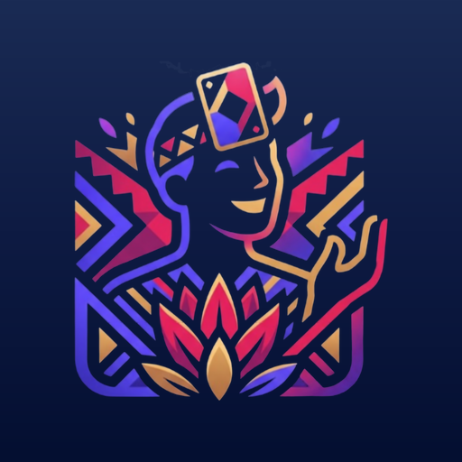
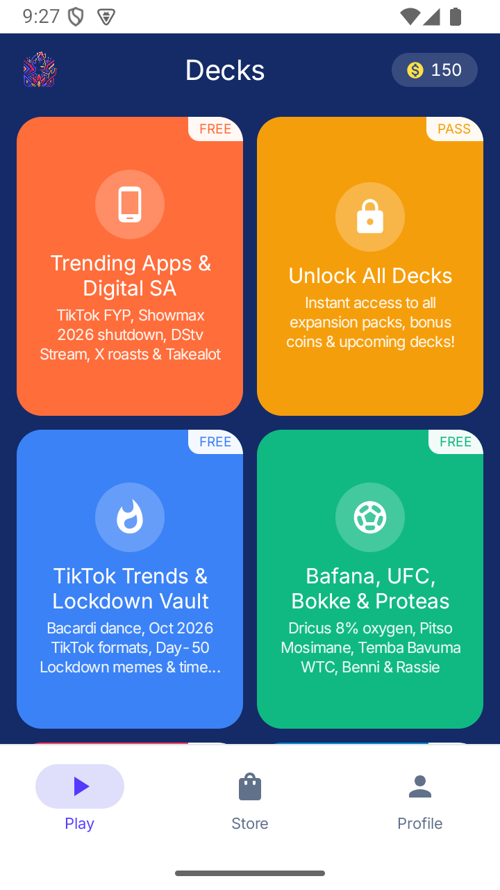
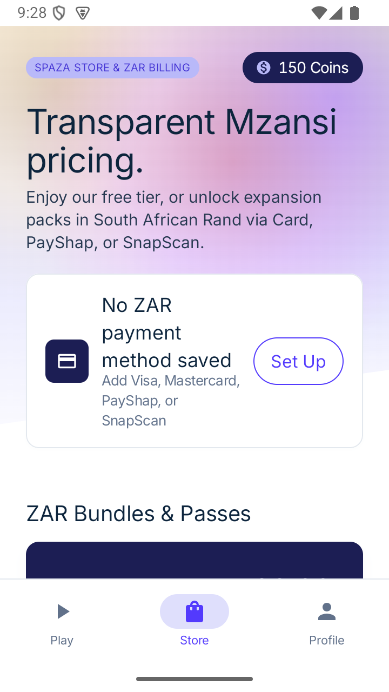
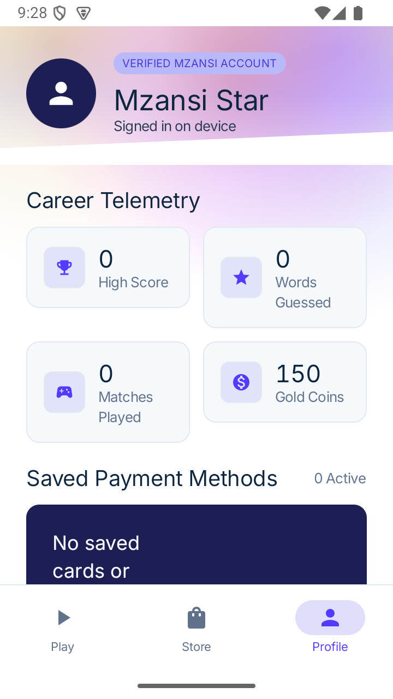
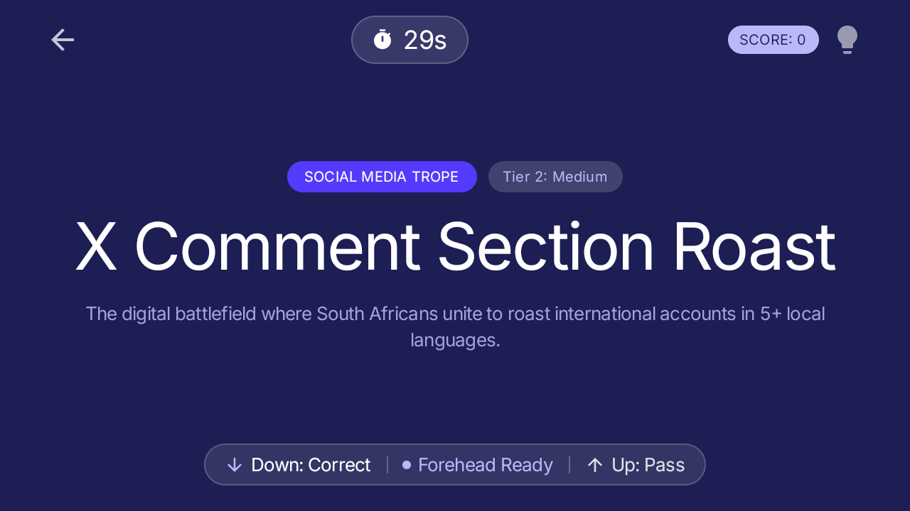

<div align="center">
  
  <h1>Mzansi Charades (Lekker Charades)</h1>
  <p>
    <strong>A native Android South African culture &amp; early-2000s-to-2026 nostalgia party game built with Kotlin, Jetpack Compose, and Firebase.</strong>
  </p>

  <p>
    
    
    
    
    <a href="LICENSE"></a>
  </p>

  <p>
    <a href="#-screenshots">Screenshots</a> •
    <a href="#-features">Features</a> •
    <a href="https://github.com/KevinAsanda/Charades/releases/latest">Download Demo APK</a> •
    <a href="#%EF%B8%8F-architecture--tech-stack">Architecture</a> •
    <a href="#-getting-started">Getting Started</a>
  </p>
</div>

---

## What Is Mzansi Charades?

**Mzansi Charades** (*displayed on-device as **Lekker Charades***) is a South African party game celebrating local pop culture, music eras, everyday life, and early-2000s nostalgia through 2026. Act out, dance, hum, or describe iconic Mzansi moments with friends—from *Zola 7* and *7de Laan* to *Amapiano*, *3-Step*, *Lekompo*, *Spaza & Tuckshop Classics*, *Bafana / Bokke / UFC / Proteas*, and *Dezemba* road trips.

The app works **offline out of the box** via local device persistence (`LocalPlayerStore`) and syncs seamlessly to **Cloud Firestore** when signed in with Google.

---

## 📱 Screenshots

<table>
  <tr>
    <td align="center" width="33%">
      <br />
      <sub><strong>Deck Lobby</strong> — Free &amp; expansion cultural decks</sub>
    </td>
    <td align="center" width="33%">
      <br />
      <sub><strong>Spaza Store</strong> — ZAR packs, daily treat &amp; rewards</sub>
    </td>
    <td align="center" width="33%">
      <br />
      <sub><strong>Player Profile</strong> — Career stats, coins &amp; wallet</sub>
    </td>
  </tr>
  <tr>
    <td align="center" colspan="3">
      <br />
      <sub><strong>Landscape Tilt Gameplay</strong> — Accelerometer forehead tilt controls (Down = Correct, Up = Pass), round timer &amp; cultural clues</sub>
    </td>
  </tr>
</table>

---

## ✨ Features

### 1. Tilt & Gesture Gameplay (`GamePlayScreen.kt`)
- **Hands-Free Forehead Tilt**: Automatically locks to landscape during rounds and uses `Sensor.TYPE_ACCELEROMETER` Z-axis detection with arming hysteresis and 1.1s debounce—tilt **down** to score (`Correct`), tilt **up** to skip (`Pass`), or use on-screen controls if no accelerometer is present.
- **4 Core Party Modes**:
  - **Act It Out** — Silent physical mime & SASL-inspired gestures
  - **Hit the Beat** — Dance choreography & humming
  - **Mzansi 30-Seconds** — Rapid verbal blitz
  - **Heads-Up Tilt** — Classic forehead-hold tilt rounds *(plus Party Teams & My Reaction support)*
- **Haptic & Audio Feedback**: Tactile vibration patterns and a shared `ToneGenerator` for round timers, correct chimes, and humorous Mzansi skip roasts.

### 2. Curated SA Cultural Decks & Custom Card Decks (`Deck.kt`, `CustomCardRepository.kt`)
- **13 Built-In Decks (110+ Cards)**:
  - **8 Free Core Decks**: *Trending Apps & Digital SA*, *TikTok Trends & Lockdown Vault*, *Bafana, UFC, Bokke & Proteas*, *Amapiano, 3-Step, Lekompo & Kwaito*, *SA TV, Soaps & Streaming (2000-2026)*, *Creators, Alter-Egos & Podcasts*, *Mzansi Slang, SASL & Tropes*, and *Spaza & Tuckshop Classics*.
  - **4 Expansion Packs + 1 Festive Pack**: *Pantsula & Zola 7 Era*, *2000s Mzansi School Days*, *December Padkos & Dezemba Groove*, *Iconic Mzansi Viral Moments*, and *Dezemba Festive Groove Pack*.
- **Custom Card Decks**: Players can create their own South African charades cards (`My Custom Mzansi Cards`) with custom categories, hints, and cultural era tags, stored locally and synced to `users/{userId}/custom_cards`.

### 3. Firestore Security Rules & Firebase App Check (`firestore.rules`, `AppCheckUtil.kt`)
- **Default-Deny Firestore Rules**: Enforces `request.auth.uid == userId` isolation across all user subcollections (`game_sessions`, `custom_cards`, `payment_methods`, `transactions`), validates field types, string lengths, enums, and numeric bounds, and keeps `game_sessions` and `transactions` receipts strictly immutable.
- **Automated Rules Unit Tests**: Verified in [`firestore.test.js`](firestore.test.js) using `@firebase/rules-unit-testing` and Node's test runner against the Firebase Emulator Suite.
- **Firebase App Check**: Configured in [`AppCheckUtil.kt`](app/src/main/java/com/example/util/AppCheckUtil.kt) with `RecaptchaAppCheckProviderFactory` for release builds and `DebugAppCheckProviderFactory` for debug builds.

### 4. Server-Side Gemini AI Architecture (Zero Client-Side API Keys)
- Built around **Firebase AI Logic / server-side Gemini attestation** using Firebase App Check so no Gemini API keys are bundled into the client APK (see [`.env.example`](.env.example)), paired with a deterministic, offline-first curated card engine so gameplay never blocks on network availability.

### 5. Offline-First Persistence & Monetization
- **Instant Offline Play**: `LocalPlayerStore` (`SharedPreferences` + `StateFlow`) persists player profiles, coin balances, daily tuckshop gifts, unlocked decks, custom cards, and match history on-device even without Firebase credentials.
- **Google Auth & Billing**: Google Credential Manager + Firebase Auth (`AuthScreen.kt`), AdMob rewarded video ads (`AdMobManager.kt`), Google Play In-App Billing (`GooglePlayBillingManager.kt`), and South African ZAR checkout flows supporting Card, PayShap, and SnapScan (`PaymentSheet.kt`).

---

## 📦 Try the Demo APK

Recruiters and reviewers can install the prebuilt signed demo APK directly on any Android 7.0+ (API 24+) device without setting up Android Studio or Firebase:

1. Download **`mzansi-charades-v1.0.0-demo.apk`** from the [**Latest GitHub Release**](https://github.com/KevinAsanda/Charades/releases/latest).
2. On your Android device, allow installation from unknown sources if prompted and install the APK.
3. Tap **Play Now on Phone** on the welcome screen to jump straight into all free Mzansi decks offline.

> **Note:** The demo APK is signed with the repository's debug keystore for easy sideloading; all free decks and local persistence work out of the box without `google-services.json`.

---

## 🛠️ Architecture & Tech Stack

| Layer | Technology |
| --- | --- |
| **Language & UI** | Kotlin `2.2.10`, Jetpack Compose (Material 3, Navigation Compose), Edge-to-Edge |
| **Android SDK** | `minSdk 24` · `targetSdk 36` · `compileSdk 36` (AGP `9.1.1`) |
| **Auth & Cloud** | Firebase Auth, Google Credential Manager, Cloud Firestore, Firebase App Check (reCAPTCHA & Debug) |
| **Offline & Local State** | `LocalPlayerStore` (`StateFlow` + `SharedPreferences`), Room dependencies configured |
| **Monetization** | Google Play Billing (`billing-ktx`), Google Mobile Ads (`play-services-ads`), ZAR checkout UI |
| **Testing** | JUnit 4, Robolectric `4.16.1`, Compose UI Test, `@firebase/rules-unit-testing` (`firestore.test.js`) |

### Project Structure

```text
├── app/src/main/java/com/example/
│   ├── MainActivity.kt                  # App Check + AdMob init & Auth/Main router
│   ├── data/
│   │   ├── local/LocalPlayerStore.kt    # Offline-first device persistence
│   │   ├── model/                       # Deck (110+ cards), CustomCard, GameSession, StorePack, PaymentModels
│   │   └── repository/                  # Firestore repositories (User, GameSession, CustomCard, Payment)
│   ├── ui/
│   │   ├── AuthScreen.kt                # Google Credential Manager + instant local phone play
│   │   ├── LobbyScreen.kt               # Deck grid, mode picker & round duration selector
│   │   ├── GamePlayScreen.kt            # Landscape tilt sensor HUD, timers, cues & results
│   │   ├── StoreScreen.kt               # Coins, ZAR bundles, expansion packs & rewarded ads
│   │   ├── ProfileScreen.kt             # Career telemetry, wallet & match history
│   │   ├── PaymentSheet.kt              # Card / PayShap / SnapScan checkout modal
│   │   └── theme/                       # Hanken Grotesk typography, Stripi colors & tokens
│   └── util/                            # AppCheckUtil, AdMobManager, GooglePlayBillingManager, FirestoreErrorHandler
├── docs/
│   ├── firebase-blueprint.json          # Firestore entity & collection schema reference
│   └── screenshots/                     # App screenshots used in README
├── firestore.rules                      # Default-deny Firestore security & validation rules
├── firestore.test.js                    # Emulator-backed Firestore rules unit tests
└── firebase.json                        # Firebase Emulator Suite config (Firestore: 8085, Auth: 9099)
```

> See [`docs/firebase-blueprint.json`](docs/firebase-blueprint.json) for the full Firestore entity and subcollection schema reference (`UserProfile`, `GameSession`, `CustomCard`, `PaymentMethod`, `PaymentTransaction`).

---

## 🚀 Getting Started

### Prerequisites
- **Android Studio** (or Android SDK Platform 36 & Build-Tools)
- **JDK 17**
- *(Optional, for Firestore rules tests)* **Node.js 18+** & **Firebase CLI**

### 1. Clone & Build Offline (No Firebase Config Required)
```bash
git clone https://github.com/KevinAsanda/Charades.git
cd Charades
gradle :app:assembleDebug
```
*(Or open the project directly in Android Studio and click **Run** — the app builds and runs offline even without `google-services.json`.)*

### 2. Optional: Enable Cloud Sync & App Check
1. Add your `google-services.json` into `app/`.
2. Add your reCAPTCHA site key string resource (`recaptcha_site_key`) for release App Check attestation, or pass `FIREBASE_APPCHECK_DEBUG_TOKEN` during debug runs (see [`.env.example`](.env.example)).

### 3. Run Firestore Security Rules Tests
```bash
firebase emulators:exec --only firestore "node --test firestore.test.js"
```

---

## 📄 License

Distributed under the **MIT License**. See [`LICENSE`](LICENSE) for details.
